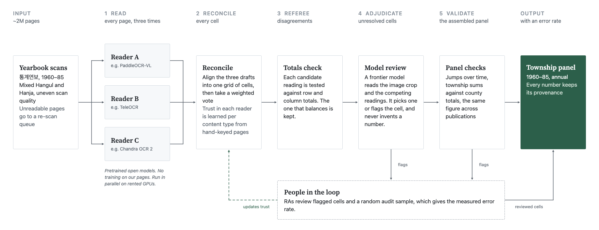

# Pipeline (draft)

From archive to analysis-ready panel in seven steps. This describes the pipeline as it is being built; details may change before release.

*Figure 1. Reading pipeline for mixed Hangul–Hanja statistical tables, built on pretrained document-AI models.*

| Step | Status |
|---|---|
| 1. Finding the yearbooks | Done |
| 2. Scanning on site | Largely complete |
| 3. Reading the tables | Current focus |
| 4. Checking the numbers | Current focus |
| 5. Variable harmonisation | Current focus |
| 6. Boundary concordances | Pilot complete |
| 7. Geocoding and GIS | Pilot complete |

## 1. Finding the yearbooks

No central archive holds the yearbooks. The National Archives of Korea hold a good number of volumes, but most surviving ones, especially the earlier years, are scattered across county offices. A systematic survey maps what exists, what is missing and where each volume is held.

## 2. Scanning on site

Volumes are scanned on site with high-speed scanners, at county offices, the National Archives of Korea and major libraries.

## 3. Reading the tables

Three pretrained open document-AI models read every page, with no training on our pages. Each cell is then settled by a weighted vote. A model's weight depends on how accurately it reads that kind of content, measured against a set of hand-keyed pages.

## 4. Checking the numbers

Each candidate reading is tested against the printed row and column totals, and the one that balances is kept. A frontier model reviews any remaining conflict and either picks a reading or flags the cell. It never supplies a number of its own. Panel checks then look for jumps over time, township sums that miss county totals, and figures that differ across publications. Research assistants review flagged cells and a random audit sample, which gives the measured error rate. Every number keeps its provenance.

## 5. Variable harmonisation

Definitions, units, and table structures changed across editions and municipalities. We build crosswalks reconciling these into consistent time series.

## 6. Boundary concordances

Two major reorganisations (1963, 1973) plus dozens of smaller changes. We construct time-consistent `miracle_id` identifiers. See [boundaries.md](boundaries.md).

## 7. Geocoding and GIS

Every township linked to satellite, elevation, slope, soil, and transport network data. 196 Namhae-gun villages fully geocoded.

## Why not train a custom reader?

| | Custom-trained pipeline (e.g. Layout Parser + EffOCR) | Pretrained readers, cross-checked (MIRACLE) |
|---|---|---|
| How pages are read | A layout detector and a character recogniser, customised to the corpus | Three pretrained document-AI models read every page side by side |
| Setting up a new corpus | Label example layouts and characters, then train | Score candidate models on a few hundred hand-keyed pages, with no training |
| Where accuracy comes from | A better-trained reader | Disagreement between readers, refereed by the tables' own totals |
| Where people spend time | Labelling training data | Reviewing flagged cells and a random audit sample |
| Strongest when | Scripts or layouts no pretrained model knows, or very large uniform collections at the lowest cost | Varied layouts, mixed scripts, and tables with built-in totals |

Layout Parser: Shen, Zhang, Dell, Lee, Carlson & Li (2021). EffOCR: Carlson, Bryan & Dell (2024).
